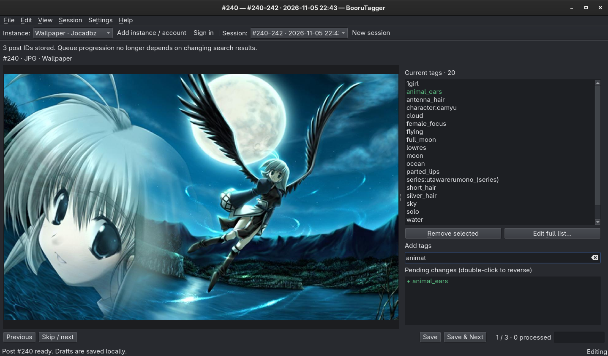
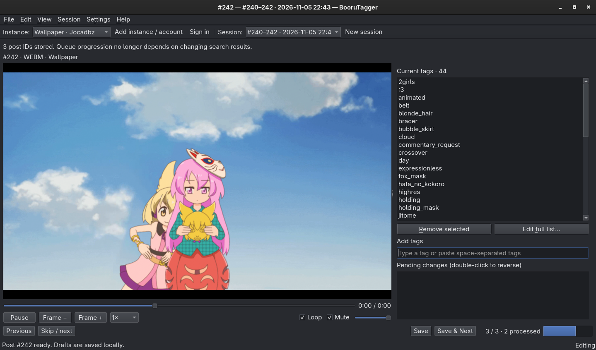

  

<h1 align="center">BooruTagger</h1>

A C++/Qt app to do a lot of tag editing on boorus (Danbooru, Shimmie, etc). 

## What it does

- Single-ID, ascending/descending range, and tag-search sessions.
- Keyboard-first tag editing, undo/redo, autocomplete, instance-specific presets, and local edit history.
- Zoomable images and an embedded libmpv player with seeking, frame stepping, speed, looping, and audio controls.
- Fetch/merge/write/verify saves. Failed or uncertain submissions keep the draft and don't blindly retry.
- Multiple server/account profiles, but only one active session. Secrets use QtKeychain when requested; otherwise they stay in memory.

## Building

Needs C++20, CMake, Ninja, Qt 6.4+ (base, OpenGL widgets, SQL/SQLite, Concurrent, Test), pkg-config, and libmpv. QtKeychain is optional. Extra Qt image-format plugins are useful.

For release, use `-B build-release -DCMAKE_BUILD_TYPE=Release` and build that directory. Optional install: `cmake --install build-release --prefix ~/.local`.

I think you can figure the rest out right? I hope so.

## Usage

Should be straightfoward, but to begin, add an account and then create a new tagging session.

## Screenshots

## Notes

Due to upstream fuckery by shimmie you will need both GraphQL and Ouroboros extensions enabled. (If your admin refuses, I'm so sorry.)

Also, I literally could not found any documentation on gelbooru edit tags, henceforth it is not supported. If somebody with enough IQ could point me that out, I would be very thankful.
